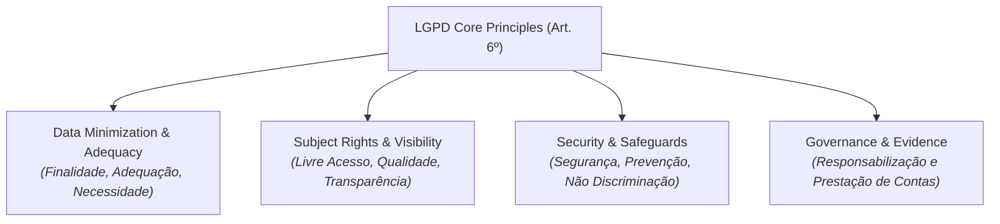
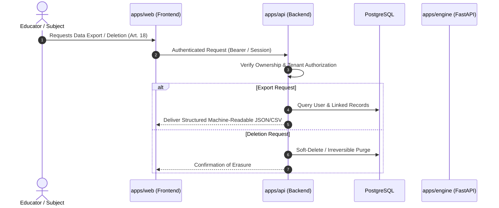

# Brazilian General Data Protection Law (LGPD) & User Privacy Guidelines

This document establishes the centralized normative baseline, legal principles, and engineering protocols for data protection and privacy across AdaptEdu. It details compliance requirements under the Brazilian General Data Protection Law (**Lei Geral de Proteção de Dados Pessoais — LGPD, Lei Federal nº 13.709/2018**), the Statute of the Child and Adolescent (**ECA — Lei Federal nº 8.069/1990**), and public administration integrity guidelines.

---

## 🎯 Purpose & Absolute Invariant

AdaptEdu is designed to support Brazilian public school educators in promoting the pedagogical inclusion of neurodivergent students (including autism, ADHD, dyslexia, dyscalculia, and Tourette syndrome). In performing this mission, the platform handles sensitive information regarding learning patterns, sensory accommodations, behavioral observations, and educator profiles.

> [!IMPORTANT]
> **Absolute LGPD Invariant:**
> Full compliance with the LGPD is a mandatory, non-negotiable architectural invariant across the entire AdaptEdu monorepo (`apps/web`, `apps/api`, `apps/engine`). **NEVER develop, propose, or deploy any feature, endpoint, database model, or AI prompt that operates outside the legal boundaries of the LGPD.**
>
> All feature implementations must adopt **Privacy by Design** and **Privacy by Default** from inception. If a technical requirement conflicts with user data protection, data privacy takes precedence.

---

## 📚 Legal & Regulatory Framework

AdaptEdu's privacy architecture is anchored in Brazilian federal legislation and official supervisory standards:

1. **Lei Federal nº 13.709/2018 (Lei Geral de Proteção de Dados Pessoais — LGPD):** Central statutory framework establishing rules on collection, handling, storage, sharing, and disposal of personal data in digital and physical media.
   - Reference: [Planalto — Lei nº 13.709/2018](https://www.planalto.gov.br/ccivil_03/_ato2015-2018/2018/lei/l13709.htm)
2. **Lei Federal nº 8.069/1990 (Estatuto da Criança e do Adolescente — ECA):** In conjunction with Art. 14 of the LGPD, governs the comprehensive protection and priority of the best interests of children and adolescents.
3. **MDS Data Protection & Integrity Guidelines:** Public administration integrity directives governing data privacy, transparency, and ethics in social and educational public initiatives.
   - Reference: [Ministério do Desenvolvimento e Assistência Social — Campanha LGPD](https://www.gov.br/mds/pt-br/acesso-a-informacao/governanca/integridade/campanhas/lgpd)
4. **Resoluções da Autoridade Nacional de Proteção de Dados (ANPD):** Regulations, security guidelines for small entities and public bodies, and incident notification directives (e.g., CD/ANPD nº 15/2024).

---

## 🏷️ Legal Concepts & Data Classification

Understanding how the LGPD classifies data is essential for engineering database schemas, DTOs, and API responses.

### 1. Personal Data (*Dado Pessoal* — Art. 5º, Inciso I)

Any information relating to an identified or identifiable natural person.
- **In AdaptEdu:** Teacher names, institutional emails, password hashes, individual taxpayer IDs (CPF), school registration numbers (matrícula), device telemetry, IP addresses, and session identifiers.

### 2. Sensitive Personal Data (*Dado Pessoal Sensível* — Art. 5º, Inciso II)

Personal data concerning racial or ethnic origin, religious conviction, political opinion, trade union membership, genetic or biometric data, and **data concerning health or sex life**.

> [!CAUTION]
> **Classification of Educational & Screening Data:**
> Observational records, neurodivergent screening answers, sensory sensitivity notes, learning difficulty indicators, and individualized pedagogical accommodation plans (*Plano de Atendimento Educacional Especializado / PDI*) constitute **sensitive health and behavioral data** under Art. 5º, II and Art. 11. They require heightened security measures, strict access boundaries, and restricted exposure.

### 3. Personal Data of Children and Adolescents (*Art. 14*)

The vast majority of public school students served by AdaptEdu are minors (children under 12 years and adolescents between 12 and 18 years).
- Under **Art. 14, § 1º**, data processing must occur strictly in the **best interest of the child or adolescent** (*no melhor interesse da criança e do adolescente*).
- Under **Art. 14, § 6º**, information on processing must be presented in clear, accessible, and age-appropriate language, taking into account the sensory and cognitive condition of the child.

### 4. Anonymized Data (*Dado Anonimizado* — Art. 5º, Inciso III & Art. 12)

Data that does not identify a subject, considering the use of reasonable technical means available at the time of processing.
- Anonymized data is legally outside the scope of the LGPD (Art. 12), provided the anonymization process is technically irreversible.
- **Pseudonymization (Art. 13, § 4º):** Processing where data can no longer be directly attributed to a subject without auxiliary information kept separately. Pseudonymized data remains subject to LGPD protections.

### 5. Actors & Governance Roles (Art. 5º, Incisos VI–IX)

| Role | Legal Definition | AdaptEdu Context |
| :--- | :--- | :--- |
| **Data Subject (*Titular*)** | Natural person to whom the personal data belongs. | Public school teachers, neurodivergent students, parents/guardians, and school administrators. |
| **Controller (*Controlador*)** | Party competent to make decisions regarding data processing. | The educational institution / municipal department of education / platform entity. |
| **Processor (*Operador*)** | Party carrying out data processing on behalf of the controller. | AdaptEdu application services, databases, and background queue workers. |
| **Data Protection Officer (*Encarregado / DPO*)** | Person designated to act as communication channel between controller, subjects, and ANPD. | Appointed security and privacy focal point overseeing privacy compliance and subject requests. |
| **Supervisory Authority (*ANPD*)** | Public administration body responsible for enforcing LGPD. | *Autoridade Nacional de Proteção de Dados*. |

---

## ⚖️ The 10 Fundamental Principles (Art. 6º) Applied to Software Engineering

Every new feature and database entity must satisfy all 10 statutory principles of the LGPD:

### 1. Purpose (*Finalidade* — Inciso I)
- **Rule:** Data must only be collected and processed for explicit, legitimate, and pedagogical purposes disclosed to the user.
- **Engineering Application:** Never repurpose student observations for secondary commercial, algorithmic profiling, or marketing purposes. Features must have a documented educational goal.

### 2. Adequacy (*Adequação* — Inciso II)
- **Rule:** Processing must be compatible with the purposes communicated to the subject.
- **Engineering Application:** Ensure database columns and API inputs directly correlate with declared feature needs. Do not ask for student home addresses if the feature only requires classroom seating positions.

### 3. Necessity & Data Minimization (*Necessidade* — Inciso III)
- **Rule:** Processing must be limited to the minimum data strictly necessary to achieve the intended purpose.
- **Engineering Application:** "Less data equals less risk." Strip unnecessary payload attributes. Default to optional fields rather than mandatory fields. Never collect demographic data that does not directly influence pedagogical adaptation.

### 4. Free Access (*Livre Acesso* — Inciso IV)
- **Rule:** Guarantee subjects free, easy consultation regarding the form and duration of processing, as well as the completeness of their records.
- **Engineering Application:** Build self-service views in `apps/web` where teachers can review all stored student profiles, adaptation plans, and screening history.

### 5. Data Quality (*Qualidade dos Dados* — Inciso V)
- **Rule:** Guarantee accuracy, clarity, relevance, and regular updating of data.
- **Engineering Application:** Provide straightforward editing interfaces. Maintain database constraints ensuring referential integrity and timestamping (`createdAt`, `updatedAt`).

### 6. Transparency (*Transparência* — Inciso VI)
- **Rule:** Guarantee clear, accurate, and easily accessible information regarding processing and data sharing.
- **Engineering Application:** All user-facing UI copy must explain in plain Portuguese (PT-BR) why a piece of information is requested and how it will be processed.

### 7. Security (*Segurança* — Inciso VII)
- **Rule:** Utilize technical and administrative measures capable of safeguarding personal data from unauthorized access, loss, or alteration.
- **Engineering Application:** TLS 1.3 in transit, strong encryption at rest, secure session cookies (`HttpOnly`, `Secure`, `SameSite=Strict/Lax`), and strict password hashing via Argon2id or bcrypt.

### 8. Prevention (*Prevenção* — Inciso VIII)
- **Rule:** Adopt proactive measures to prevent the occurrence of damage resulting from data processing.
- **Engineering Application:** Automated security scanning, dependency vulnerability audits, DTO validation with property whitelisting, and authorization checks on every endpoint.

### 9. Non-Discrimination (*Não Discriminação* — Inciso IX)
- **Rule:** Strict impossibility of carrying out processing for unlawful, discriminatory, or abusive purposes.
- **Engineering Application:** Pedagogical recommendations must empower learners and dismantle educational barriers. The platform must never produce exclusionary classifications, punitive scoring, or discriminatory labels against neurodivergent children.

### 10. Accountability & Governance (*Responsabilização e Prestação de Contas* — Inciso X)
- **Rule:** The controller/processor must demonstrate the adoption of effective measures capable of proving compliance with data protection rules.
- **Engineering Application:** Comprehensive audit logs for data modifications, automated test suites verifying privacy invariants, and clear version tracking.

---

## 🛡️ Legal Bases for Processing (Art. 7º & Art. 11)

In AdaptEdu, data processing is justified strictly under authorized statutory grounds:

1. **Compliance with Legal or Regulatory Obligation (Art. 7º, II & Art. 11, II, "a"):**
   - Assisting educators in fulfilling constitutional mandates for inclusive education (CF/88 Art. 205, 208), the *Lei de Diretrizes e Bases da Educação Nacional* (LDB 9.394/1996), and the *Lei Brasileira de Inclusão* (LBI 13.146/2015 Art. 28).
2. **Execution of Public Policies (Art. 7º, III & Art. 11, II, "b"):**
   - Public education delivery and pedagogical accommodations implemented by public administration bodies.
3. **Explicit Consent (Art. 7º, I & Art. 11, I & Art. 14, § 1º):**
   - Informed consent provided by educators for account creation and explicit parental/guardian consent where required for personalized student digital records.

---

## 👤 Data Subject Rights (Art. 18 & Art. 20) & Technical Delivery

The application architecture must provide technical mechanisms to satisfy data subject requests (*Direitos dos Titulares*):

1. **Confirmation of Processing & Data Access (Art. 18, I & II):**
   - Dedicated dashboard endpoint enabling users to download all stored personal data in a structured, machine-readable format (JSON/CSV).
2. **Correction of Incomplete, Inaccurate, or Outdated Data (Art. 18, III):**
   - Full self-service edit capabilities on student profiles and user settings.
3. **Anonymization, Blocking, or Elimination (Art. 18, IV & VI):**
   - Clear deletion endpoints: account termination triggers deletion or irreversible anonymization of linked records, respecting statutory document retention obligations.
4. **Revocation of Consent (Art. 18, IX):**
   - Clear toggles to withdraw consent, stopping non-essential data collection immediately.
5. **Right to Review Automated Decisions (Art. 20):**
   - **Crucial Rule:** The platform **MUST NEVER** apply automated, purely algorithmic determinations that affect student rights, grades, or placements.
   - All AI insights from `apps/engine` are presented strictly as suggestions requiring educator validation (human-in-the-loop).

---

## 🏛️ Domain Architectural Protocols (Monorepo Layout)

Each application in the AdaptEdu monorepo enforces specific, mandatory LGPD requirements:

```mermaid
flowchart LR
    subgraph Web["apps/web (Frontend)"]
        W1["No sensitive data in URLs/query params"]
        W2["HttpOnly, Secure Cookies"]
        W3["PT-BR Transparent Privacy Notices"]
        W4["No sensitive logs in browser console"]
    end

    subgraph API["apps/api (Backend Core)"]
        A1["Prisma select projection (No over-fetching)"]
        A2["IDOR defense & Tenant verification"]
        A3["Immutable Audit Logs"]
        A4["DTO input whitelisting"]
    end

    subgraph Engine["apps/engine (AI Reasoning)"]
        E1["Strict Pseudonymization before LLM"]
        E2["Zero real student identifiers in prompts"]
        E3["Zero-retention external API configuration"]
        E4["Hypothesis-Only & Non-Diagnostic Principle"]
    end

    Web -->|HTTP API| API
    API -->|Sanitized HTTP Job| Engine
```

### 1. Frontend Protocols (`apps/web`)

- **No Personal Data in URLs:** Never pass CPFs, student names, phone numbers, or tokens in query strings or route parameters (e.g., `?student_name=Joao` is strictly prohibited). Use opaque UUIDs.
- **Client Storage Hygiene:** Never store sensitive student observations or health traits in browser `localStorage` or `sessionStorage`. Store session tokens exclusively in `HttpOnly`, `Secure`, `SameSite=Lax/Strict` cookies.
- **Console Log Sanitation:** Never log form payloads, user credentials, or API response bodies containing personal data via `console.log()` in client components.
- **Accessible Privacy Notices:** Provide clear, plain-language notices in Brazilian Portuguese (PT-BR) explaining why information is required at the point of input.
- **No Diagnostic Labels:** Adhere strictly to the non-diagnostic principle; UI components must label outputs as observational hypotheses, not clinical diagnoses.

### 2. Backend Protocols (`apps/api`)

- **Strict Prisma Projection (Anti-Data Exposure):** Never return unpruned database models directly to the client. Always utilize explicit Prisma `select` blocks or DTO serialization to omit internal flags, password hashes, and unrelated relational data.
- **Ownership Verification (Anti-IDOR):** Every endpoint operating on student data must verify that the authenticated user (`req.user.id`) is authorized to access the specific classroom or student record. Never trust client-provided IDs without server-side validation.
- **Immutable Audit Logging:** Maintain structured audit logs recording:
  - Timestamp of access.
  - Authenticated user ID (*Quem acessou*).
  - Target entity and action (*Qual dado foi acessado, alterado ou excluído*).
  - **Invariant:** Audit logs must record actions and IDs, but **must never log sensitive payload values** (such as plaintext passwords or full psychological notes) in application log files.
- **Data Retention & Stale Purging:** Implement scheduled background jobs to clean up abandoned draft screenings or transient files.
- **Zero Hardcoded Secrets:** Credentials and encryption keys must always reside in `.env` files, never in version control.

### 3. AI & Reasoning Engine Protocols (`apps/engine`)

- **Pseudonymization Before Third-Party AI Calls:**
  - Before sending prompt context to third-party LLM providers (e.g., OpenAI API), all identifying details must be stripped or masked.
  - Real names, school names, student IDs, and municipal identifiers must be replaced with synthetic tokens (e.g., `[ESTUDANTE_A]`, `[TURMA_01]`).
- **Zero-Retention API Configuration:**
  - External AI requests must enforce zero-data-retention headers and configurations preventing third-party vendors from using public school student data for model training.
- **Non-Diagnostic Constraint Satisfaction:**
  - All prompt templates in `apps/engine` must instruct the model to frame insights strictly as observational educational hypotheses based on scientific literature, directing educators to liaise with pedagogical coordination and qualified healthcare professionals.
- **Output Validation:** Validate all LLM completions using Pydantic v2 schemas before returning payloads to the backend API.

### 4. Automated Testing, Seeds & Development

- **100% Synthetic Mock Data:**
  - All automated tests (Vitest, Jest, Pytest), Playwright E2E suites, and database seed scripts (`prisma/seed.ts`) must use synthetic mock data generated with `@faker-js/faker` or factory utilities.
  - **Never use real student names, real CPFs, real phone numbers, or real clinical records.**
- **No Production Dumps in Staging/Local:**
  - Developers and agents must never import production database backups containing real personal data into local or staging environments.

---

## 📋 Pre-Commit LGPD Feature Checklist

Before considering any feature, endpoint, or component complete, developers and AI agents must verify:

- [ ] **Data Minimization:** Does this feature collect only the minimum personal data strictly necessary for its pedagogical purpose?
- [ ] **Sensitive Data Handling:** Are student behavioral observations and accommodations treated as sensitive health data with restricted access?
- [ ] **No Client Leaks:** Are URLs, query parameters, client console logs, and browser storage free of sensitive personal data?
- [ ] **Access Control & Authorization:** Does the backend verify that the authenticated teacher owns or has authorized access to the requested student/classroom resource?
- [ ] **Prisma Projections:** Are database queries using explicit `select` statements to avoid leaking internal or sensitive attributes?
- [ ] **AI Data Scrubbing:** Are student prompts stripped of real names and identifiers before dispatching to external LLMs?
- [ ] **Non-Diagnostic Compliance:** Does the feature avoid formulating medical or clinical diagnoses, framing insights as pedagogical hypotheses?
- [ ] **Synthetic Test Data:** Are all test fixtures and database seeds using generated fake data (`@faker-js/faker`)?
- [ ] **User Rights (Art. 18):** Can the data collected be edited, viewed, and deleted by authorized users upon request?

---

## 🚨 Security Incident & Breach Notification Protocol (Art. 46 & 48)

In the event of a security incident resulting in accidental or unlawful destruction, loss, alteration, or unauthorized disclosure/access of personal data:

1. **Immediate Containment:** Revoke compromised tokens/keys, isolate affected database or API instances, and patch vulnerable endpoints.
2. **Internal Logging:** Record the incident scope, affected records, nature of exposed data, and containment measures in an immutable security report.
3. **Statutory Notification:** If the incident poses relevant risk or damage to data subjects:
   - Notify the **ANPD** in accordance with official timeframes and regulatory guidelines.
   - Notify affected **educators and legal guardians** in clear, transparent language detailing the nature of the data involved, risks, and mitigating actions taken.

---

## 🔗 Related Governance Documents

- [AGENTS.md](AGENTS.md): Root repository instructions and global invariants.
- [docs/ACCESSIBILITY_GUIDELINES.md](docs/ACCESSIBILITY_GUIDELINES.md): Inclusive education legislation and architectural mapping matrix.
- [docs/skills/code-review-security/SKILL.md](docs/skills/code-review-security/SKILL.md): Security code review protocol and vulnerability checklist.
- [docs/GITHUB.md](docs/GITHUB.md): Git workflows and pull request governance.
